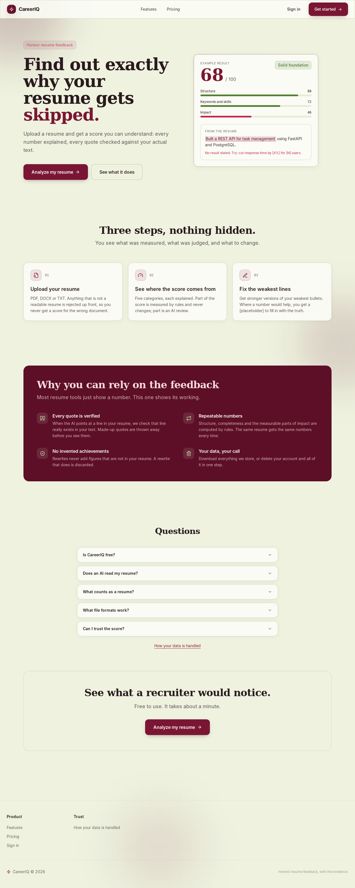
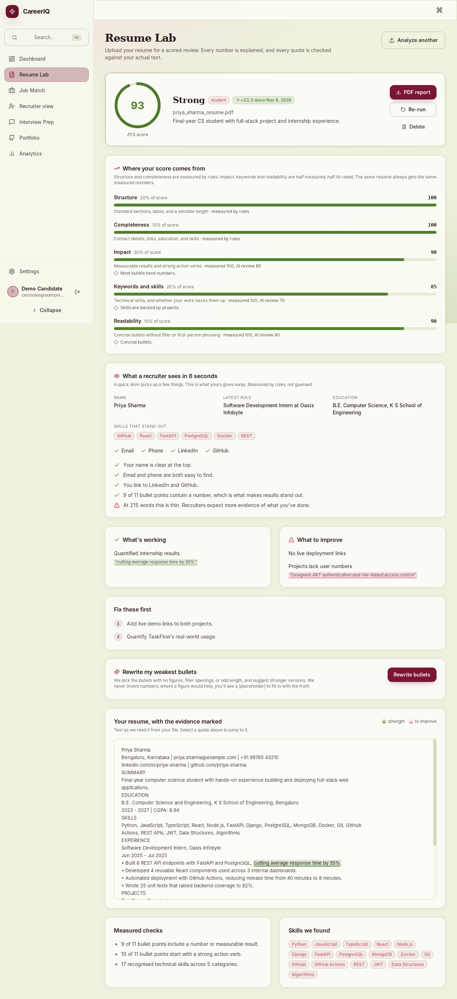
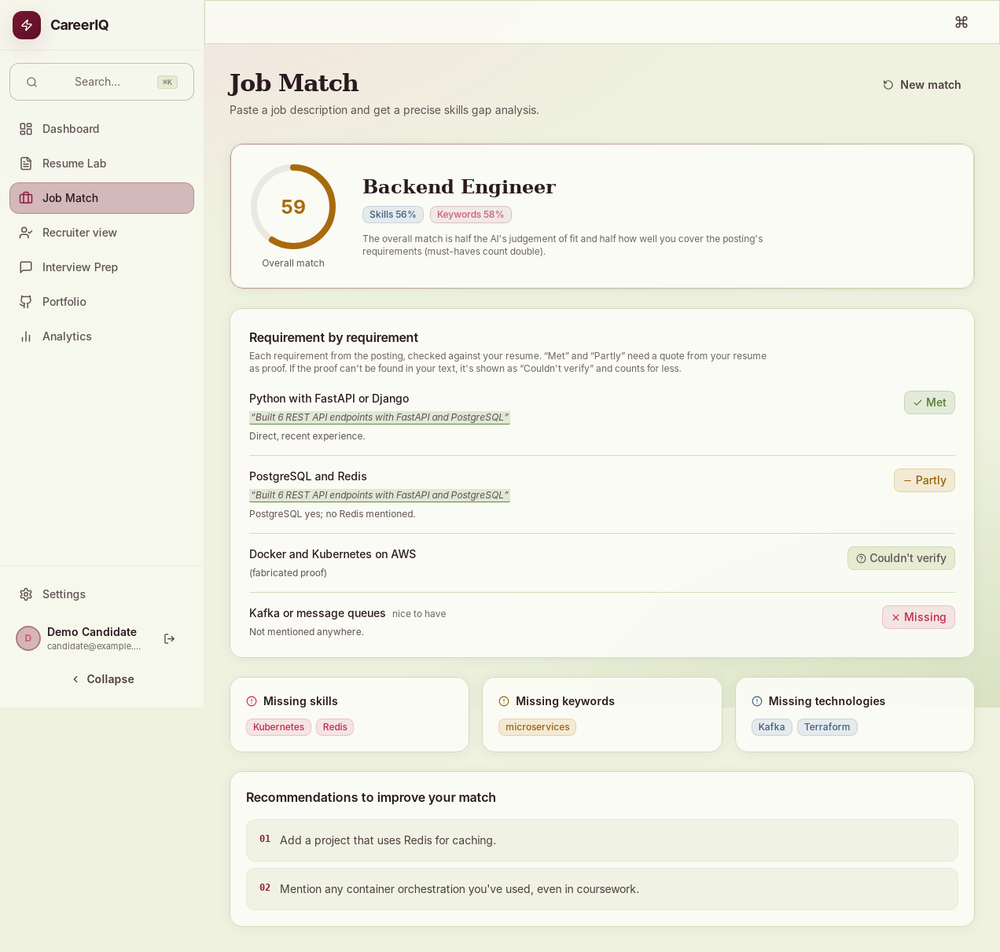
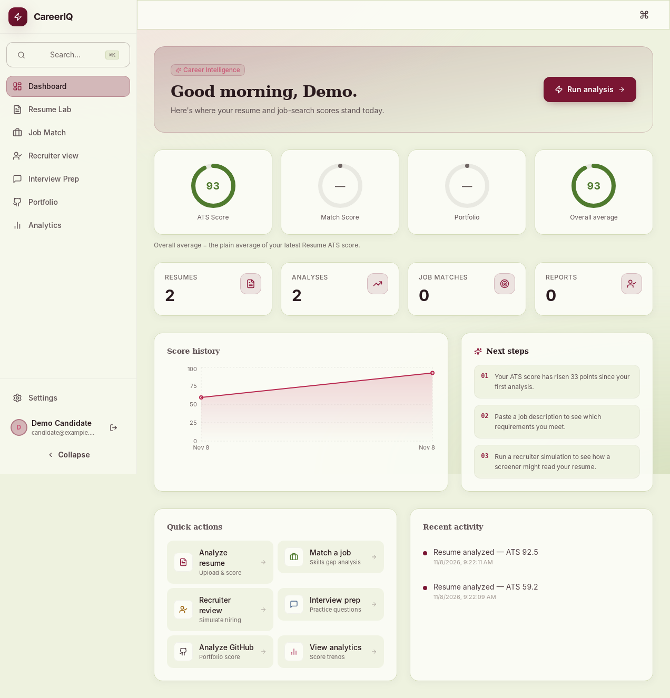
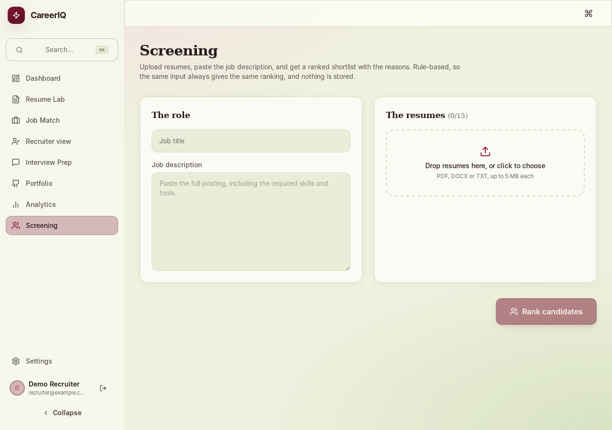
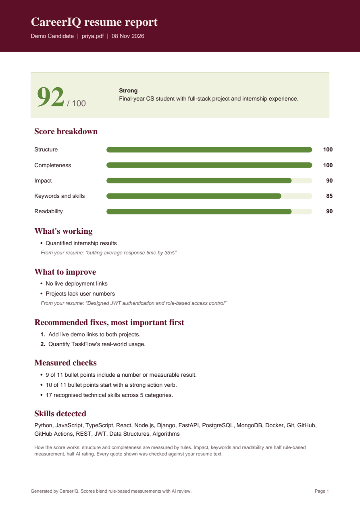

# CareerIQ: honest resume feedback

Upload a resume and get a score you can understand. Every number is explained, and every quote the AI gives is
checked against your actual text before you see it. Includes a recruiter workspace for ranking many resumes against a job.

## Screenshots

| | |
|---|---|
|  |  |
|  |  |
|  |  |

*Captured from the running app with demo data. Headings use Fraunces when the Google Font loads; these captures fall back to a system serif.*

## What it does

| Feature | What you get |
|---|---|
| **Resume Lab** | ATS score with a five-category breakdown, strengths and weaknesses with verified quotes highlighted in your resume, recommendations, progress since your last analysis, downloadable PDF report |
| **Bullet rewriter** | Stronger versions of your weakest bullets. Never invents numbers: unknown figures become `[placeholders]` |
| **Six-second scan** | What a recruiter's first glance picks up (name, role, skills, contact and links). Rule-based, free |
| **Job Match** | Each requirement in a posting checked against your resume: met, partly, missing, or "couldn't verify", with proof quotes |
| **Recruiter view** | An AI screener's estimated shortlist chance, verdict, risks and likely interview questions |
| **Interview Prep** | Questions tailored to the role and to the projects in your resume |
| **Portfolio Analyzer** | Scores a public GitHub profile from real repository data (forks ignored) |
| **Screening** *(recruiter/admin)* | Rank up to 15 resumes against a job description. Rule-based and explainable; nothing is stored |
| **Account** | Change name and password, download all your data, delete your account |

## How the score works

1. **Validate.** File type, size and real content are checked. Scans, garbled files, password-protected PDFs and
   non-resumes (invoices, papers, job descriptions) are rejected with a specific reason.
2. **Measure.** Structure, completeness, quantified results, action verbs, skills and readability are computed in
   plain Python. The same resume always gets the same measured numbers.
3. **Review.** An AI rates impact, relevance and clarity and points at lines in the resume.
4. **Verify.** Quotes, skills and employers the AI mentions are checked against the resume text. Anything that
   isn't really there is dropped. Rewrites that add numbers not in the original are discarded.
5. **Blend.** Impact, keywords and readability are 50% measured, 50% AI. Structure and completeness are fully measured.

## Quick start

```bash
cp .env.example .env
# Add GEMINI_API_KEY (free at https://aistudio.google.com/apikey)
docker compose up --build
```

- Frontend: http://localhost:5173
- API: http://localhost:8000 (docs at `/docs`, status at `/health`)

Without Docker:

```bash
# backend
cd backend
python -m venv .venv && source .venv/bin/activate      # Windows: .venv\Scripts\activate
pip install -r requirements.txt
uvicorn app.main:app --reload                          # uses SQLite unless DATABASE_URL is set

# frontend (new terminal)
cd frontend
npm install
npm run dev
```

Open `/health` after starting: `"ai": {"configured": true}` means your key was found.

For separate local processes, copy `backend/.env.example` to `backend/.env` for backend settings and
`frontend/.env.example` to `frontend/.env.local` when the API is not at `http://localhost:8000/api/v1`.
The root `.env.example` is the Docker Compose template.

## AI providers

Set `AI_PROVIDER` in `.env`: `gemini` (default, free tier), `ollama` (free, runs locally), `openai`, or `anthropic`.
There is no mock data: without a working provider the analysis endpoints return a clear `503` explaining what to set.
Free tiers have rate limits, and some providers may use free-tier content to improve their products, so avoid real
personal documents on a free tier unless you accept that.

## Accounts and roles

With `DEMO_MODE` on (the default in development) these accounts exist, password `DemoPass123!`:

| Role | Email | Can use |
|---|---|---|
| Candidate | candidate@example.com | Everything except Screening and admin |
| Recruiter | recruiter@example.com | Everything plus Screening |
| Admin | admin@example.com | Everything plus `GET /api/v1/admin/overview` |

Roles are enforced by the API, not just hidden in the UI. Demo accounts are off by default in production.

## Production checklist

- `ENVIRONMENT=production` (refuses to start with a weak `SECRET_KEY`; set a random 32+ character value)
- `BACKEND_CORS_ORIGINS` set to your real frontend URL
- `DATABASE_URL` pointing at PostgreSQL
- Rate limits and the daily AI quota live in server memory: with several workers each has its own count.
  Move them to Redis or your reverse proxy if you scale out.
- Existing databases are upgraded on startup (new columns added, any old plaintext passwords converted to bcrypt).

## Deployment architecture

The intended hosted layout is:

- **Render:** deploy `backend/` as a Python web service and attach a managed PostgreSQL database. Start the service
  with `uvicorn app.main:app --host 0.0.0.0 --port $PORT`; set the production variables from `backend/.env.example`.
- **Vercel:** deploy `frontend/` as a Vite application. Set `VITE_API_URL` to the public Render API URL ending in
  `/api/v1`, and set the backend `BACKEND_CORS_ORIGINS` to the Vercel URL.
- **Secrets:** add provider keys, `DATABASE_URL`, and a generated 32+ character `SECRET_KEY` in the hosting
  dashboards. Do not put them in the repository or frontend build variables unless they are intentionally public.

The backend owns authentication, resume storage, document parsing, scoring, AI-provider calls, reports, and the
PostgreSQL/SQLite data layer. The frontend is a React single-page application that calls the versioned API. Local
Docker Compose runs PostgreSQL, the FastAPI service, and the Vite development server together.

API documentation is available from the running backend at `/docs` (Swagger UI) and `/redoc`; the health check is
at `/health`.

## Tests

```bash
cd backend && pip install -r requirements-dev.txt && pytest -q     # 130 tests, AI calls mocked
cd frontend && npm install && npm test                             # 49 tests, includes full-page flows
```

The backend suite also passes against PostgreSQL 16 (`DATABASE_URL=...`).

## Project structure

```
backend/app/
  api/v1/endpoints/   auth, resumes, features, recruiter_tools (screening, admin)
  core/               config, security (bcrypt, JWT), ratelimit, errors, deps (role checks)
  services/           ai_service, llm (provider layer), document_parser, resume_gate,
                      resume_scoring, resume_insights, report (PDF), screening
  db/                 session, additive migrations
backend/tests/
frontend/src/
  pages/              Landing, ResumeLab, JobMatch, Recruiter, Screening, Dashboard, Settings, ...
  components/resume/  score breakdown, evidence viewer, scan card, rewriter
  test/               Vitest + Testing Library
```
